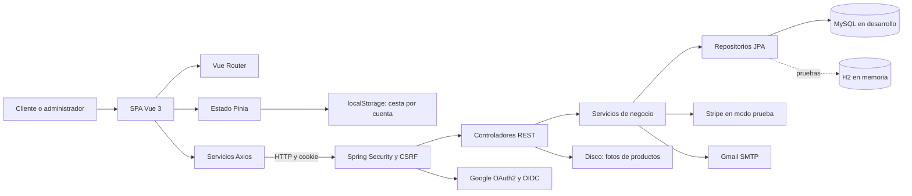
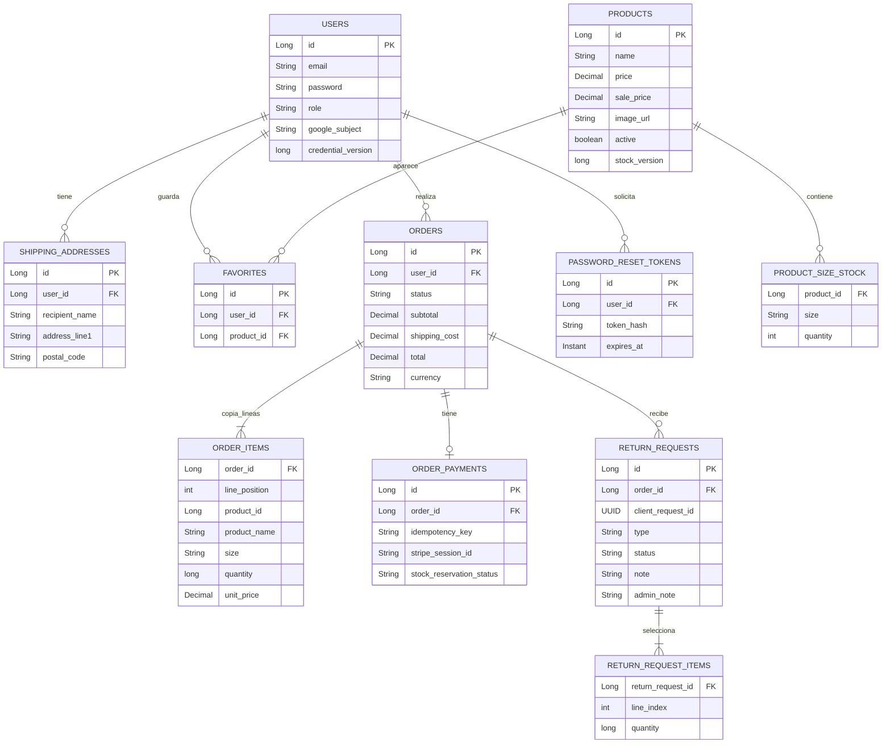
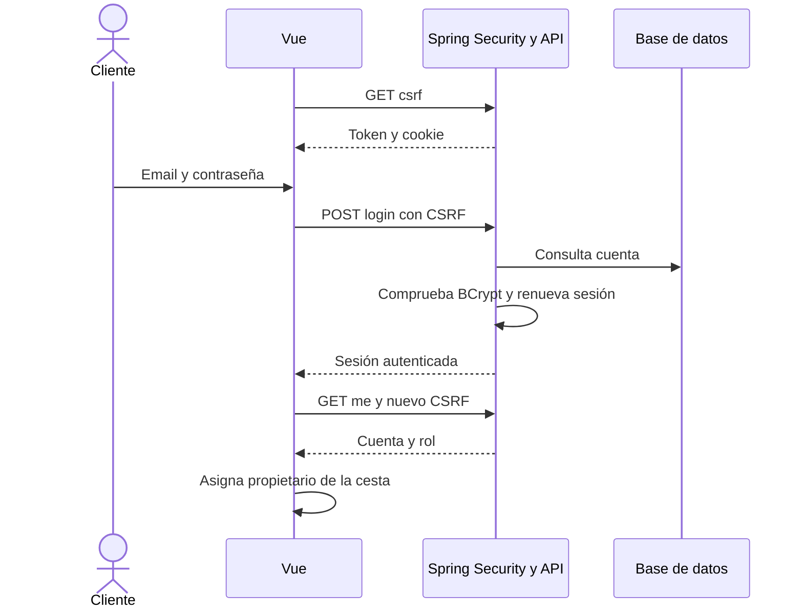
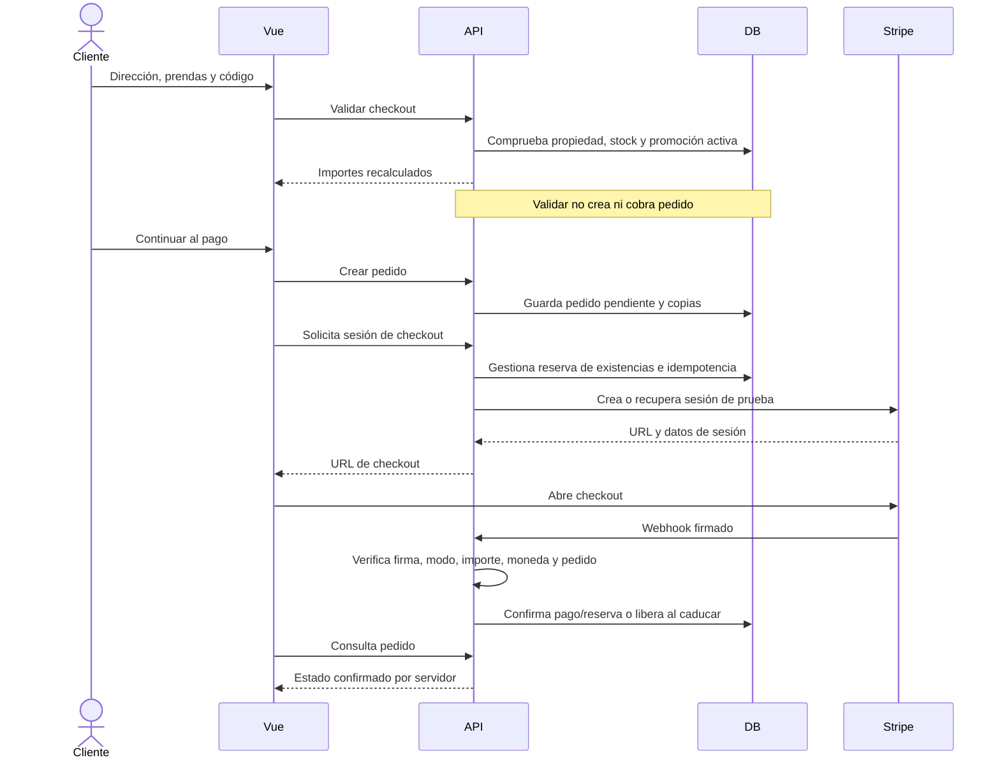
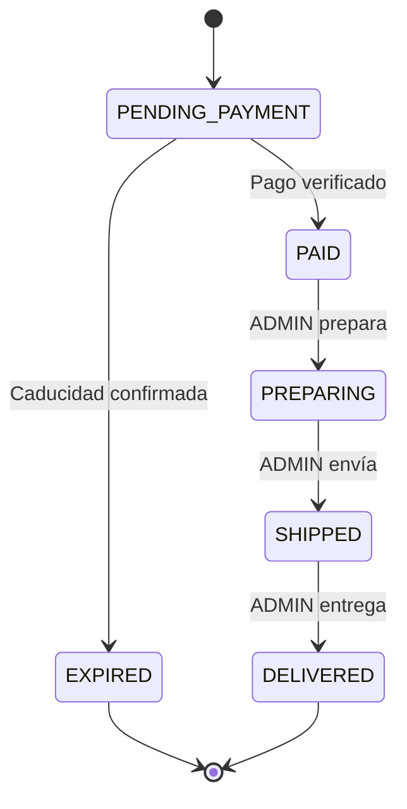
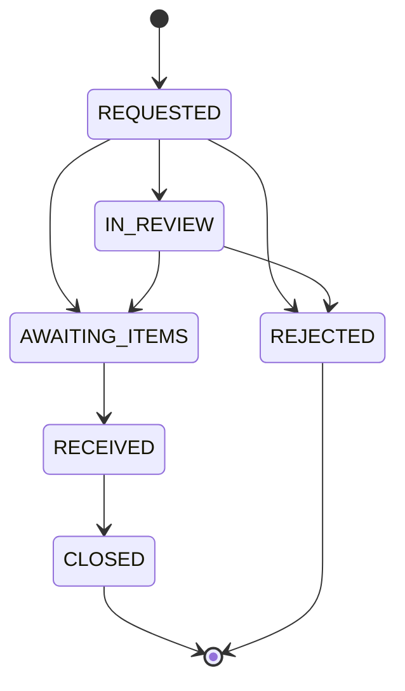
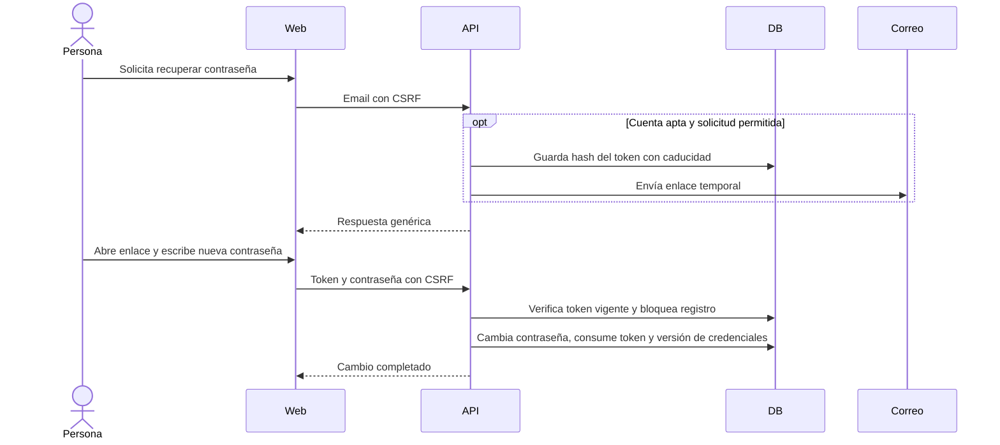

# Diagramas del backend

## Arquitectura por capas

El backend es una aplicación organizada por capas, no microservicios. El frontend es una SPA con componentes, vistas, servicios y stores. El servidor aplica permisos y reglas de negocio aunque el navegador ya compruebe el acceso.

## Modelo de datos principal

Diagrama lógico simplificado. Se distinguen las entidades de las colecciones de valores. No se dibuja una clave foránea inexistente desde el producto actual a la copia de una línea de pedido.

El atributo password guarda la contraseña codificada. product_id en ORDER_ITEMS es un valor escalar de la copia del pedido, no una FK JPA hacia PRODUCTS. OrderShippingAddress está embebida en orders, sin tabla propia. PRODUCT_SIZE_STOCK, ORDER_ITEMS y RETURN_REQUEST_ITEMS son colecciones de valores. Contact, ShopSettings, PromotionalCode y PromotionalPopup son modelos adicionales sin relación de propietario representada en este diagrama. PromotionalPopup guarda el código como texto, no como FK JPA.

## Sesión y CSRF

## Compra y confirmación de pago

La creación de sesión puede fallar y la reserva se gestiona según el resultado. Webhook y reconciliación evitan depender del retorno del navegador. La integración actual acepta modo prueba.

## Estados del pedido

No se permite avanzar directamente de pagado a entregado ni retroceder estados. Las repeticiones del mismo estado admitidas por el modelo son idempotentes.

## Estados de devolución

CLOSED se muestra como Finalizada y REJECTED como No aceptada; ambos requieren respuesta explicativa. El flujo gestiona la solicitud y no llama a un reembolso automático. Una prenda defectuosa se atiende por correo según la política.

## Recuperación de contraseña

